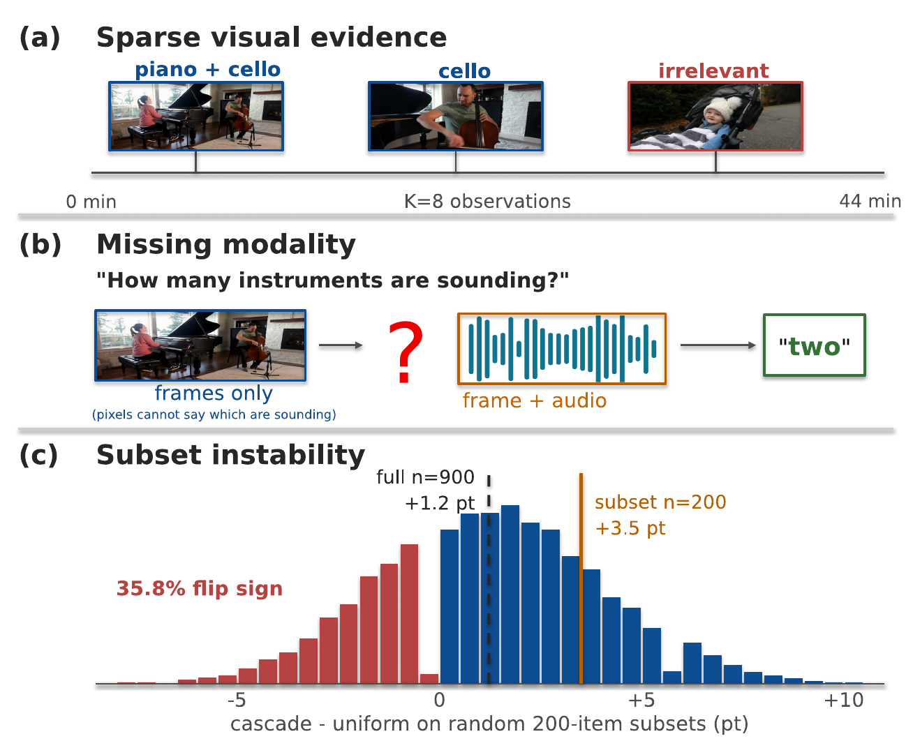
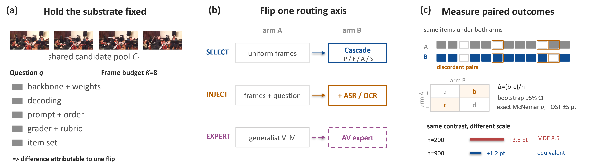
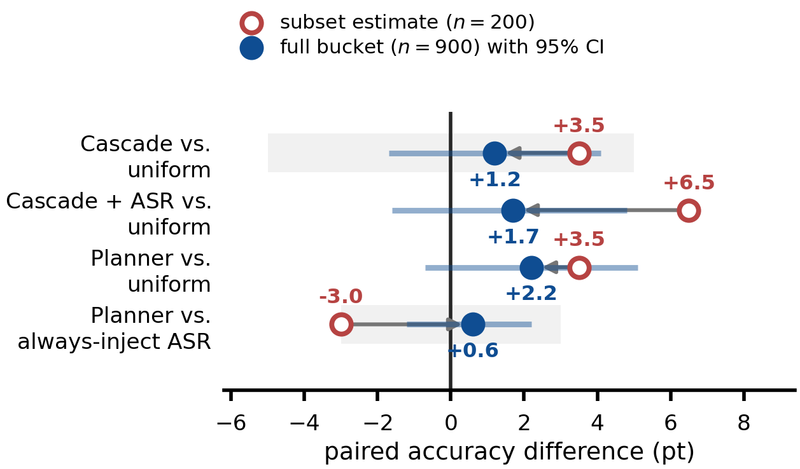
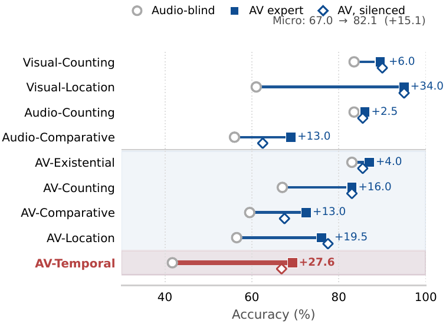

# Long-Video QA Audit

**Where do reported long-video QA gains come from?**
A controlled audit of *frame selection*, *evidence injection*, and *expert routing*.

**Shih-Yao Lin · Independent Researcher · WACV 2027**

To cite this work, see [Citation](#citation).

This repository is the code release for **VideoRouteAudit**, a controlled audit
protocol and harness, **not** a leaderboard method. Everything here exists to make one kind of comparison
possible: hold the backbone, frame budget `K`, prompt scaffold, decoding
configuration and grader fixed, then vary exactly one routing decision at a
time and measure what actually changes.

---

## Headline findings

| | Finding |
|---|---|
| **F1** | At `K=8` on the **full** Video-MME long bucket (`n=900`), no tested selector significantly improves over uniform sampling. Every selection-only rule is statistically *equivalent* to uniform within a ±5 pt margin (none within ±3 pt), so a literature-scale gain is ruled out and a small one is not. |
| **F2** | Three of four matched contrasts are **1.6–3.8× larger** on the commonly used `n=200` subsets and the fourth (planner vs. always-inject ASR) reverses sign. Resampling 200-item subsets from the full-bucket predictions flips the sign of the full-bucket effect in **35.8%** of draws. The minimum detectable effect at `n=200` is **8.3–10.4 pt** — larger than the 1–5 pt gains this literature reports. |
| **F3** | Routing gains are domain-, protocol- and model-dependent. The pooled cascade+ASR gain (+4.7 pt on the three `n=200` development subsets) shrinks to +1.6 pt outside the development prefix, and the published anomaly-domain "+ASR" arms injected nothing. With transcripts, where the ASR block sits in the prompt changes its sign (XD-Violence −10.0 pt appended, 0.0 before the question; UCF-Crime −13.0 pt either way; Video-MME +4 pt when placed first, post hoc, unadjusted). Swapping the answering model gives the largest contrast on MUSIC-AVQA (+15.1 pt), but the same audio-visual expert with its soundtrack silenced keeps 92% of it: mostly a model swap. |

### The audit at a glance

<p align="center"></p>

**Figure 1.** Three obstacles to long-video QA claims. (a) `K` frames must cover a
44-minute timeline. (b) Some questions need sound, not pixels alone. (c) Across 20,000
random `n=200` subsets of our cached `n=900` outcomes, 35.8% reverse the sign of the
full-bucket effect.

<p align="center"></p>

**Figure 2.** Matched contrasts are the unit of measurement: backbone, budget, decoding,
prompt, grader and items stay fixed while one routing decision flips. The ported selectors
share one candidate pool; the cascade scores its own (see the note under the main table),
so cascade-vs-uniform compares pipelines, not selection rules alone.

<p align="center"></p>

**Figure 3 (F2).** Subset-scale estimates (hollow, `n=200`) against the full-bucket
estimate of the same contrast (filled, `n=900`, 95% CI). Three of four are larger at
`n=200` and one reverses sign.

<p align="center"></p>

**Figure 4 (F3b).** MUSIC-AVQA, same judge, 200 questions per type: audio-blind
Qwen2-VL-7B (circle), the audio-visual expert (square) and the same expert with its
soundtrack silenced (diamond). Swapping the answering model gives the largest contrast,
and most of it survives silencing the audio: mostly a model swap.

### Main result — Video-MME long, `K=8`, `n=900`

| Method | Acc. (%) | Δ | 95% CI | *p* | Wall s/item |
|---|---:|---:|:---:|---:|---:|
| Uniform-`K` | 46.2 | — | — | — | 10.0 |
| Midpoint uniform-`K` (stronger baseline) | 46.2 | 0.0 | [−2.8, +2.9] | 1.00 | — |
| AKS (port) | 48.1 | +1.9 | [−1.2, +5.0] | 0.273 | 22.3 |
| KeyScore (port) | 47.1 | +0.9 | [−2.2, +4.0] | 0.624 | 22.4 |
| VideoTree (port) | 47.8 | +1.6 | [−1.6, +4.8] | 0.360 | 22.3 |
| Cascade (selection only) | 47.4 | +1.2 | [−1.7, +4.1] | 0.452 | 13.3 |
| Cascade + OCR | 47.2 | +1.0 | [−1.9, +4.0] | 0.552 | 21.6 |
| Cascade + ASR | 47.9 | +1.7 | [−1.6, +4.8] | 0.337 | 12.8 |
| Cascade + ASR, text before the question † | 50.2 | +4.0 | [+0.6, +7.3] | 0.024 | — |
| Uniform + ASR, text before the question † | 50.7 | +4.4 | [+1.8, +7.2] | 0.002 | — |
| ProcMem planner | **48.4** | +2.2 | [−0.7, +5.1] | 0.154 | 15.7 |

Backbone: `Qwen2.5-VL-7B-Instruct`. Paired McNemar tests, unadjusted; CIs are paired
bootstrap intervals. † A post hoc placement variant of ASR injection (the evidence
block ahead of the question instead of after the options, `--evidence_position
before`; `question` and `instruction` are the two intermediate positions), added after the anomaly-domain results; they are the only rows with
*p* < 0.05 (the cascade's gain over its no-text version is +2.8 pt, CI [+0.1, +5.6],
*p* = 0.055). No tested *selection rule* significantly improves on uniform.
Every number in this table is recomputed offline from
the released per-item predictions by `python scripts/replay_paper_stats.py`
(see [Quick start](#quick-start)).
Ported selectors are reimplementations of the *selection rule* scoring the
same 256-frame candidate pool — they are not the original authors' full
pipelines (at `K=8` the official AKS rule returns no frame, so its port is a
binned top-`K`; [`docs/CAVEATS.md`](docs/CAVEATS.md) and `results/port_fidelity.json` give the measured
fidelity). The cascade scores its own 132-candidate pool and keeps half of
its frames as uniform anchors.

Historical experiment records:
[`results/RESULTS_SNAPSHOT.md`](results/RESULTS_SNAPSHOT.md).
That earlier snapshot is not the final matched audit; use the table above
for the paper's main result.

## Repository layout

```
audit_predictions.py  Loads per-item outcomes (raw run directories or the shipped package)
audit_stats.py        Paired statistics shared by the analysis scripts (McNemar, bootstrap, TOST)
data_paths.py         Dataset-root resolution (LONG_VIDEO_QA_DATA_ROOT)
cascade/            Core five-stage routing pipeline
  proposers/        L1 candidate proposal: uniform_stride, stacfp, shot_boundary, ears_event
  filters/          L1 filtering: redundancy, motion_diff
  aligners/         L2 alignment encoders: semantic/object SigLIP, OCR, ASR, CLAP, audio energy
  planner.py        Rule-based keyword planner + LLM planner
  router.py         CascadeRouter orchestration
  skill_cards.py    Loader for the self-contained skill catalogue
baselines/          Ported selectors: AKS, KeyScore, VideoTree, motion-only, clip-only, uniform, random
evidence_skills/    Cached skill implementations (EARS, Whisper, EasyOCR, SigLIP, CLAP)
router/             Backbones (Qwen2.5-VL, LLaVA-Video, LLaVA-NeXT-Video, VideoLLaMA2-AV), experts, memory, datasets
skills/             Self-contained skill cards (YAML frontmatter, 13 cards) + expert policy
configs/            Per-dataset YAML configs + procedural-memory versions
submodular.py       Lazy-greedy facility-location selector
fusion.py           Score normalization and weighted fusion
temporal_nms.py     Temporal suppression selector
scripts/            Runnable entry points + analysis
  paper_runs/       Paper experiment drivers (see reproduction notes below)
tests/              CPU unit tests (no GPU, no raw outputs needed)
.github/            CI: tests + offline replay of the paper's statistics
requirements.txt    Pinned GPU environment;  requirements-test.txt: CPU tests only
docs/               System overview, runbook, procedural-memory semantics, release checklist
figures/            Paper figures + their build scripts
results/            Durable result records (raw outputs are not shipped)
CITATION.cff        GitHub "Cite this repository" metadata, preferring the paper
citation.bib        Copyable BibTeX for the paper
```

---

## Quick start

Verify every number in the paper without a GPU (shipped per-item predictions):

```bash
pip install -r requirements-test.txt
python scripts/package_predictions.py --verify    # shipped outcomes agree with the manifest
python scripts/replay_paper_stats.py --check      # ~10 s; recomputes the paper's statistics
python -m pytest tests/ -q                        # CPU unit tests
```

Run the pipeline on one video and question (GPU, model weights required):

```bash
python scripts/run_one.py --video clip.mp4 --question "What is the man in the red shirt doing?" --budget 8
```

| Document | Content |
|---|---|
| [`docs/USAGE.md`](docs/USAGE.md) | Benchmark runner, cascade and planner, reproducing the paper runs, analysis scripts, tests, figure inventory |
| [`docs/SETUP.md`](docs/SETUP.md) | Environment, model weights, datasets, optional API keys |
| [`docs/CAVEATS.md`](docs/CAVEATS.md) | What the audit does and does not establish; read before citing a number |
| [`docs/SYSTEM_OVERVIEW.md`](docs/SYSTEM_OVERVIEW.md), [`docs/RUNBOOK.md`](docs/RUNBOOK.md) | Architecture and operations |
| [`docs/RELEASE_CHECKLIST.md`](docs/RELEASE_CHECKLIST.md) | Publication readiness and outstanding artifacts |

## Scope and caveats

- Ported AKS, KeyScore and VideoTree reimplement the *selection rule* only; the results do not bear on the original systems.
- The audited cascade differs from the default pipeline, and its candidate pool and uniform anchors differ from the ported selectors', so cascade-vs-uniform compares pipelines.
- Findings are for Video-MME long at `K=8` with Qwen2.5-VL-7B (plus the stated checks); generalization beyond them is untested.
- Placement variants, the planner rows and the anomaly-QA conversions are post hoc or development-informed; see [`docs/CAVEATS.md`](docs/CAVEATS.md).

---

## Citation

Please cite the paper when using the code or audit protocol. Download
[`citation.bib`](citation.bib), or use GitHub's **Cite this repository**
button (configured by [`CITATION.cff`](CITATION.cff)).

```bibtex
@inproceedings{lin2027longvideoaudit,
  author    = {Lin, Shih-Yao},
  title     = {Where Do Reported Long-Video {QA} Gains Come From? A Controlled Audit of Frame Selection, Evidence Injection, and Expert Routing},
  booktitle = {IEEE/CVF Winter Conference on Applications of Computer Vision (WACV)},
  year      = {2027},
}
```

## License

Released under the MIT License — see [`LICENSE`](LICENSE). Datasets and model
weights are governed by their own licenses.
